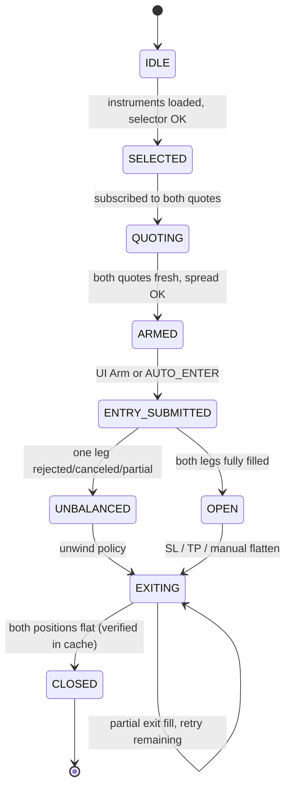

# BTC ATM Short Straddle: Implementation Plan and Architecture

NautilusTrader + Bybit Testnet, with a live monitoring dashboard.

---

## 1. Goal and priorities

**Task:** Sell one ATM call and one ATM put (same strike, same expiry) on BTC options through NautilusTrader on Bybit Testnet.

- **Level 1:** naked straddle, no stop-loss or take-profit. Track acknowledgements, fills and positions.
- **Level 2:** exit both legs when the combined ask-side buyback premium is **+1% (stop-loss)** or **-2% (take-profit)** versus the combined entry premium. Handle partial fills and duplicate exits.
- **Submission:** a live demo and walkthrough on a call. Nothing is uploaded.

**What is really being judged:** curiosity, initiative, and whether you can explain the execution flow. The UI is a differentiator, but only on top of a core you fully understand.

**Priority order:**

1. Core strategy (Level 1, then Level 2)
2. Tests
3. Dashboard UI
4. Polish and rehearsal

**Design rule:** keep the code small enough to explain every file. Use fewer, thicker modules than a textbook layered design.

---

## 2. Facts verified against the NautilusTrader Bybit docs

Verify these again against the version you install.

| Topic | Verified fact |
|---|---|
| Options support | Supported as `CryptoOption` instruments. Symbol suffix is `-OPTION`, for example `BTC-27MAR26-70000-P-USDT-OPTION` |
| Account | Options require a Bybit Unified Trading Account (UTA). Nautilus uses a MARGIN account with NETTING OMS |
| Environment | `BybitEnvironment.TESTNET` on both data and exec client configs |
| Credentials | Env vars `BYBIT_TESTNET_API_KEY` and `BYBIT_TESTNET_API_SECRET` |
| Instrument loading | Clients load only configured `product_types`. Default is `LINEAR`, so set `product_types=[BybitProductType.OPTION]` |
| Option quotes | Come from the WebSocket **ticker** feed |
| Option data available | Bid/ask and sizes, Greeks, mark price, index price, **per-expiry underlying reference price**, open interest, L2 book deltas |
| Bars | **No kline/candle data for options** |
| Order types (options) | `MARKET` and `LIMIT` only. No conditional orders (`STOP_*`, `*_IF_TOUCHED`) |
| TP/SL on options | Position-level trading stops **not supported**. Strategy must monitor and exit itself |
| Time in force | `GTC`, `IOC`, `FOK` supported. `DAY`, `GTD` natives are not |
| Reduce-only | Supported for options |
| Batch submit | Supported. Max 5 option orders per batch. **Not atomic**, so legs can succeed or fail independently |
| Position mode | One-way only for options |
| Rate-limit/timeouts | Some failures (10006, 10429, timeouts) emit **no** rejection event. The order stays "in flight" until a later update or reconciliation |
| Testnet keys | API keys are created on the desktop website. New users may be blocked from creating keys for the first 48 hours |

**Not yet verified, so check in your install:** exact `CryptoOption` attribute names, the option-chain subscription signature, and the node-builder API (the current docs reference `LiveNode.builder(...)`; copy from `examples/live/bybit/` in the repo for your version).

---

## 3. System architecture

### 3.1 Component view

```
┌─────────────────────────────────────────────────────────────────────────┐
│                          Single Python process                          │
│                                                                         │
│  ┌──────────────────────── Nautilus LiveNode (main thread) ───────────┐ │
│  │                                                                    │ │
│  │   BybitDataClient ──► DataEngine ──► Cache ◄── ExecutionEngine ◄── BybitExecClient
│  │         ▲                  │          ▲              │             │ │
│  │         │                  ▼          │              ▼             │ │
│  │         │           ┌─────────────────────────────────────┐        │ │
│  │         │           │         StraddleStrategy            │        │ │
│  │         │           │  state machine + event handlers     │        │ │
│  │         │           │   uses ► selector.py  (pure)        │        │ │
│  │         │           │   uses ► risk.py      (pure)        │        │ │
│  │         │           └───────┬─────────────────▲───────────┘        │ │
│  └─────────┼───────────────────┼─────────────────┼────────────────────┘ │
│            │          events/snapshots      commands                    │
│            │                   ▼                 │   (thread-safe       │
│            │          ┌────────────────────────────┐   queues)          │
│            │          │   FastAPI + WebSocket      │  (background       │
│            │          │   server (uvicorn thread)  │   thread)          │
│            │          └────────────┬───────────────┘                    │
└────────────┼───────────────────────┼────────────────────────────────────┘
             │                       │ WS + REST
        Bybit Testnet                ▼
  (REST + public/private/trade   React dashboard (browser)
   WebSockets)
```

### 3.2 Data flow (market data)

```
Bybit option ticker WS
   → BybitDataClient (parses to QuoteTick, greeks, ref price)
   → DataEngine → Cache
   → Strategy.on_quote_tick(tick)
        → update latest-quote store for that leg
        → if state == OPEN: risk.evaluate(...) → maybe request_exit()
        → throttled snapshot → UI queue
```

### 3.3 Execution flow (orders)

```
Strategy.submit_order(order)
   → RiskEngine (Nautilus pre-trade checks)
   → ExecutionEngine → BybitExecClient (WS trade channel / HTTP)
   → Bybit
   ← private WS execution + order streams
   ← OrderSubmitted / OrderAccepted / OrderFilled / OrderRejected / OrderCanceled
   → Strategy.on_order_* handlers → state machine transitions
   → Cache updates positions (NETTING, one net position per instrument)
```

### 3.4 Threading and the UI bridge

Nautilus is not thread-safe. The rules:

- The strategy runs only on the node's event loop thread.
- The API server runs in a background thread and **never calls strategy methods**.
- **Out (strategy → UI):** the strategy pushes JSON-serializable events and throttled snapshots into a `queue.Queue`. A bridge coroutine in the API thread reads it and broadcasts over WebSocket.
- **In (UI → strategy):** REST endpoints put command dicts (`ARM`, `DISARM`, `FLATTEN`, `UPDATE_CONFIG`) on a command queue. The strategy drains this queue from a `clock.set_timer(...)` callback every ~200 ms.

---

## 4. Project structure

```
btc-straddle/
├── main.py                 # build node, register strategy, start API thread
├── config.py               # env + defaults (qty, sl_pct, tp_pct, stale_secs, unwind policy)
├── selector.py             # PURE: choose expiry, ATM strike, call+put
├── risk.py                 # PURE: entry premium, buyback cost, SL/TP decision
├── strategy.py             # Nautilus Strategy: state machine + handlers
├── bridge.py               # queues + snapshot/event schema
├── server.py               # FastAPI: REST, WebSocket, static files
├── sim/
│   └── replay.py           # synthetic/recorded quote feed for demo mode
├── web/                    # React + Vite dashboard
├── tests/
│   ├── test_selector.py
│   ├── test_risk.py
│   ├── test_state_machine.py
│   └── test_duplicate_exit.py
├── logs/
├── .env.example
├── .gitignore              # includes .env, logs/
├── requirements.txt
└── README.md
```

`selector.py` and `risk.py` import nothing from Nautilus. They take plain numbers or simple dataclasses, which makes them trivial to unit test and to explain.

---

## 5. Configuration

`.env` (never commit):

```
BYBIT_TESTNET_API_KEY=...
BYBIT_TESTNET_API_SECRET=...
```

`config.py` parameters:

| Parameter | Default | Meaning |
|---|---|---|
| `QTY` | smallest allowed | Contracts per leg (respect instrument min/increment) |
| `SL_PCT` | 0.01 | Stop when buyback ≥ entry × (1 + SL_PCT) |
| `TP_PCT` | 0.02 | Take profit when buyback ≤ entry × (1 - TP_PCT) |
| `STALE_QUOTE_SECS` | 5 | Max quote age to allow entry/evaluation |
| `MAX_SPREAD_PCT` | tune | Refuse to arm if combined spread is too large vs premium |
| `ENTRY_ORDER_STYLE` | `ioc_limit` | `market` or `ioc_limit` at the bid |
| `EXIT_ORDER_STYLE` | `ioc_limit` | Marketable limit at ask plus buffer, reduce-only |
| `LEG_FAIL_POLICY` | `unwind` | `unwind` or `retry_missing_leg` |
| `EXIT_WATCHDOG_SECS` | 10 | Re-check unresolved exit orders after this long |
| `AUTO_ENTER` | false | If false, entry waits for the UI Arm button |

---

## 6. Module specifications

### 6.1 `selector.py` (pure)

**Input:** list of option records (underlying, kind, strike, expiry, instrument_id, tradable flag), a reference price per expiry, current time.

**Algorithm:**

1. Keep only BTC, active, unexpired options in the supported settlement currency.
2. Group by expiry. Keep expiries that have at least one strike with **both** a call and a put.
3. Pick the nearest future expiry. Skip any that lack a full pair or whose reference price is missing.
4. Within that expiry, restrict to strikes that have both legs, then choose `argmin |ref_price - strike|`. Tie-break deterministically (for example the lower strike) and document it.
5. Return `(expiry, strike, call_id, put_id, ref_price)` or a reason for failure.

**Never mix expiries.** Never hard-code a symbol.

### 6.2 `risk.py` (pure)

```python
def entry_premium(legs):          # legs: [(qty, avg_fill_price, multiplier), ...]
    return sum(q * m * p for q, m, p in legs)

def buyback_cost(legs, asks):     # asks: current ask per leg, same order
    return sum(q * m * a for (q, m, _), a in zip(legs, asks))

def thresholds(entry, sl_pct, tp_pct):
    return entry * (1 + sl_pct), entry * (1 - tp_pct)

def decide(cost, entry, sl_pct, tp_pct):
    sl, tp = thresholds(entry, sl_pct, tp_pct)
    if cost >= sl: return "STOP_LOSS"
    if cost <= tp: return "TAKE_PROFIT"
    return None
```

**Worked example:** entry fills 1000 and 900 give E = 1900. SL = 1919, TP = 1862. Asks 960 and 900 give cost 1860, which is ≤ 1862, so TAKE_PROFIT.

Notes:

- Use **actual average fill prices and filled quantities**, not the quotes seen before submitting.
- Use the **open quantity from the cache** for each leg, not the requested quantity.
- With equal quantity and multiplier on both legs, percentages are scale-invariant. Still read `multiplier` from the instrument so the PnL display in the UI is correct.
- Use `Decimal` or Nautilus `Price`/`Quantity` for thresholds. Avoid raw float equality at boundaries.

### 6.3 `strategy.py`

#### State machine



#### Event handlers and responsibilities

| Handler | Responsibility |
|---|---|
| `on_start` | Check cache for existing positions/orders on target instruments (restart safety). Request or read instruments, run selector, subscribe to quotes, start command-drain timer |
| `on_quote_tick` | Store latest quote per leg with timestamp. If `OPEN`, run risk decision. Emit throttled snapshot |
| `on_order_submitted` / `on_order_accepted` | Log and record lifecycle event |
| `on_order_filled` | Update per-leg filled qty and average price. Decide `OPEN` vs `UNBALANCED` (entry) or progress toward `CLOSED` (exit) |
| `on_order_rejected` / `on_order_denied` | Distinguish venue rejection from local denial. Trigger the leg-failure policy |
| `on_order_canceled` / expired | IOC remainders arrive here. Compute residual and act |
| `on_position_opened` / `on_position_closed` | Cross-check against strategy bookkeeping |
| timer callbacks | Drain UI commands, run exit watchdog, stale-quote checks |
| `on_stop` | Cancel open orders. Leave positions untouched unless a flatten was explicitly requested |

#### Entry procedure

1. Preconditions: state `ARMED`, no open positions on either instrument, both quotes fresh, bids positive, bid sizes ≥ QTY, spread check passes.
2. Create two SELL orders (market or IOC limit at the bid). Store both `ClientOrderId`s.
3. Submit. Move to `ENTRY_SUBMITTED`.
4. Reach `OPEN` only when **both** legs report filled quantity equal to the target. Record the entry premium.

#### Exit procedure

1. `request_exit(reason)` returns immediately if state is already `EXITING` or `CLOSED`.
2. Set state to `EXITING`. Log the reason and the numbers that triggered it.
3. Read open quantity per leg **from the cache**. Skip any leg already flat.
4. Submit BUY orders: marketable IOC limit at the ask plus a small buffer, with `reduce_only=True`.
5. Track exit order IDs and outstanding quantity per leg.
6. On partial fill or IOC cancel with remainder, re-submit for the remainder (bounded retries, then alert in the UI and keep state `EXITING`).
7. Move to `CLOSED` only when the cache shows both positions flat.

#### Duplicate-exit protection (three layers)

1. **State guard:** `EXITING` ignores further triggers, even if 100 ticks arrive.
2. **Quantity from cache:** orders are sized to what is actually open, so a retry can never over-buy.
3. **`reduce_only=True`:** because options are one-way netting, an extra BUY would otherwise flip you long. With reduce-only, an excess order cannot increase exposure.

#### Failure matrix

| Situation | Action |
|---|---|
| Call fills, put rejected/denied | `UNBALANCED` → unwind call (reduce-only buy) → verify flat |
| Both legs partially filled unequally | Cancel residuals, unwind both filled quantities (default policy) |
| Entry order stuck in flight (no ack) | Watchdog: re-check cache and order state; if still unresolved, cancel and reconcile before any new action |
| Exit order rejected | Retry with refreshed ask; escalate in UI after N attempts |
| Exit partially filled | Re-submit remainder only |
| Quote stale while `OPEN` | Do not trigger on stale data. Show warning in UI. Keep watching |
| Disconnect while `OPEN` | On reconnect, rely on Nautilus reconciliation, then compare cache to strategy state before acting |
| Process restart with positions | Detect on start. Do not enter again. Adopt or flatten per config |

#### Known design trap: spread can trigger the stop instantly

You sell at the **bid** but value the buyback at the **ask**. If the combined bid-ask spread is larger than about 1% of the combined premium, the position is at or past the stop-loss immediately after entry without any market movement.

Example: bids 1000 + 900 = 1900 (entry). Asks 1020 + 920 = 1940. Buyback is already +2.1%.

Plan:

- Implement the valuation exactly as the brief says (ask-side).
- Compute and display `spread_pct = (sum(ask) - sum(bid)) / sum(bid)` before arming.
- Add `MAX_SPREAD_PCT` so the UI shows "not safe to arm" instead of stopping out instantly.
- Choose the most liquid expiry and strike for the demo.
- Mention this proactively in the walkthrough.

---

## 7. Dashboard UI

### 7.1 Stack

- **Backend:** FastAPI + uvicorn (background thread), WebSocket for live push, REST for commands.
- **Frontend:** React + Vite + Tailwind. Charts with `lightweight-charts` or Recharts.
- **Delivery:** `vite build` output served as static files by FastAPI, so the demo needs one command (`python main.py`) and one URL.

### 7.2 Panels

| Panel | Contents |
|---|---|
| Header bar | Connection status (data/exec), `TESTNET` badge, strategy state pill, **Arm**, **Flatten now**, **Kill switch** |
| Selection card | Underlying reference price, expiry, strike ladder with ATM highlighted, call and put instrument IDs, selection reasoning |
| Live quotes | Bid, ask, sizes per leg, quote age with a freshness indicator, spread % |
| Straddle monitor (main chart) | Combined buyback cost over time, with horizontal lines for entry premium, SL threshold and TP threshold; marker when exit triggers |
| Positions | Per leg: side, open qty, avg entry, current ask, unrealized PnL; totals |
| Orders | Table of every order: leg, side, type, qty, status, filled qty, avg price, lifecycle timestamps |
| Event timeline | Every state transition and decision with reason text (for example `TP: 1860 <= 1862`) |
| Config drawer | QTY, SL%, TP%, policy options. Locked while a straddle is open |
| Mode banner | `LIVE TESTNET` or `SIMULATION` (always visible, impossible to miss) |

### 7.3 Interfaces

**REST (UI → backend):**

| Endpoint | Purpose |
|---|---|
| `GET /api/state` | Full current snapshot (used on page load/reconnect) |
| `POST /api/arm` | Allow entry once preconditions pass |
| `POST /api/disarm` | Cancel pending arm |
| `POST /api/flatten` | Request manual exit |
| `POST /api/config` | Update parameters when allowed |
| `GET /api/events?since=` | Event history |

**WebSocket `/ws` (backend → UI):** messages are JSON with a `type` field.

```json
{"type": "snapshot", "ts": 1763380000123,
 "state": "OPEN", "mode": "testnet",
 "selection": {"expiry": "...", "strike": 91000, "ref_price": 91250,
               "call": "...", "put": "..."},
 "quotes": {"call": {"bid": 1000, "ask": 1020, "bid_sz": 5, "ask_sz": 3, "age_ms": 240},
            "put":  {"bid": 900,  "ask": 920,  "bid_sz": 4, "ask_sz": 6, "age_ms": 180}},
 "risk": {"entry": 1900, "cost": 1940, "sl": 1919, "tp": 1862, "spread_pct": 0.021},
 "positions": [...], "orders": [...]}

{"type": "event", "ts": 1763380001000, "level": "info",
 "code": "STATE", "text": "ENTRY_SUBMITTED -> OPEN"}
```

Throttle snapshots to ~4-10 per second regardless of tick rate.

### 7.4 Simulation / replay mode

Waiting for a real 1-2% move on testnet could take a long time, so the demo needs a deterministic way to show every behavior. Build `sim/replay.py` that feeds scripted or recorded quote sequences into the **same** `risk.py` and state machine, with a fake execution layer, for these scenarios:

1. Take-profit hit
2. Stop-loss hit
3. One leg rejected → unwind
4. Partial exit fill → retry remainder
5. 100 duplicate trigger ticks → exactly one exit

Rules: the UI banner must say `SIMULATION`, and in the walkthrough say plainly which parts are simulated and which ran on testnet.

---

## 8. Testing strategy

**Unit tests (no network):**

| Area | Cases |
|---|---|
| Selector | nearest expiry; skip expiry missing a leg; ATM nearest strike; tie-break; missing ref price; mixed underlyings filtered |
| Risk | SL boundary exactly at threshold; TP boundary; no trigger in between; multiplier handling; unequal open quantities |
| State machine | both fill → OPEN; one reject → UNBALANCED → unwind; partial fills; exit retry; ignored triggers while EXITING |
| Duplicate exit | 100 ticks after trigger → one set of orders |
| Stale data | stale quote never triggers an exit |

**Integration on testnet (progressive, stop at each gate):**

1. **No orders:** instruments load, BTC options found, quotes stream, ref price present.
2. **Minimum-size entry and manual exit:** verify accepted/filled events and cache positions.
3. **Full Level 2:** SL and TP logic live (with adjusted thresholds for a quick demo, clearly labeled).
4. **Fault checks:** kill the process with an open position and restart; drop the network briefly.

**Evidence to keep:** one clean log file and a short screen recording of a full cycle, as a fallback if the live demo misbehaves.

---

## 9. Milestones and acceptance criteria

| # | Milestone | Done when |
|---|---|---|
| 0 | Accounts and environment | Testnet account, test coins, API key created (allow up to 48h), venv, `nautilus_trader` installed, one repo example runs |
| A | Connectivity | Node starts against testnet; instruments for OPTION load; table of BTC expiries/strikes printed; live quotes for any option print continuously |
| B | Selection | Selector picks expiry/strike/call/put; unit tests pass; subscribed to both legs |
| C | Level 1 | Two sells submitted; accept/fill events logged; positions verified in cache; state reaches `OPEN` |
| D | Level 2 | Risk module, exit path, duplicate protection, reduce-only exits, leg-failure unwind, watchdog, restart check |
| E | Tests | Unit suite green; integration gates 1-3 passed |
| F | Dashboard | Bridge working; all panels live; Arm/Flatten work through the command queue |
| G | Sim mode and rehearsal | All five scenarios demoable; walkthrough rehearsed twice; fallback recording saved |

Do not start milestone C until A works. Do not start F until D works.

---

## 10. Walkthrough preparation

Map each question from the brief to something you can open and point at:

| Question | Your answer and where to show it |
|---|---|
| How does NautilusTrader start? | `main.py`: config → data and exec client configs → node build → strategy registered → run |
| How is Bybit configured? | `BybitEnvironment.TESTNET`, `product_types=[OPTION]`, env-var credentials, UTA requirement |
| How is market data received? | Option ticker WebSocket → adapter → `QuoteTick` → `on_quote_tick` |
| How are option instruments identified? | Loaded into the cache on connect; `selector.py` filters and matches by underlying, kind, strike, expiry |
| How does the strategy receive events? | Subscribed quote ticks plus order/position event handlers |
| How are orders submitted? | `order_factory` → `submit_order` → execution engine → Bybit exec client |
| How do we know accepted or executed? | `on_order_accepted`, `on_order_filled`, `on_order_rejected`; timeline panel shows each |
| How are positions tracked? | Nautilus cache (netting, one position per instrument) plus strategy bookkeeping; cross-checked before `CLOSED` |
| How are SL and TP implemented? | `risk.py` on every quote while `OPEN`; ask-side buyback vs entry; exchange-side TP/SL unsupported for options so exits are strategy-driven |
| One leg executes, other does not? | `UNBALANCED` state; default unwind with reduce-only buy; policy configurable |

**Be ready to discuss unprompted:**

- The spread-triggers-stop trap and how you handled it
- Why exits use `reduce_only` and cache-based quantities
- Why the API thread never touches the strategy directly
- What simulation proves versus what testnet proves, and that neither proves profitability

**If something is unfinished:** say so, explain what you tried, and show your debugging path. The brief explicitly values that over copied code.

---

## 11. Risks and mitigations

| Risk | Mitigation |
|---|---|
| API key delay (up to 48h) | Create the account first, today |
| Thin testnet liquidity or wide spreads | Pick liquid strike; IOC limit orders; spread gate; log spread at entry |
| Docs differ from installed version | Copy config from repo examples for your version; inspect objects with `dir()` |
| Silent in-flight orders (rate limits, timeouts) | Exit/entry watchdog and cache reconciliation |
| Duplicate or flipped exposure | State guard + cache-sized + reduce-only exits |
| Live demo fails | Sim mode, recorded run, saved logs |
| Overbuilding | Hold milestone order; UI only after core passes tests |
| AI-generated code you can't explain | Read each module aloud once; keep modules small; rehearse the Q&A table |

---

## 12. Final checklist

- [ ] Testnet account, test coins, API key
- [ ] Node connects; `OPTION` instruments loaded; quotes streaming
- [ ] Selector tested; nearest expiry and ATM strike correct
- [ ] Level 1: two sells, events tracked, positions verified
- [ ] Level 2: SL +1% and TP -2% on combined ask-side buyback
- [ ] Reduce-only exits, duplicate guard, partial-fill retry, watchdog
- [ ] One-leg-failure unwind tested
- [ ] Restart safety (no blind re-entry)
- [ ] Unit tests green; integration gates passed
- [ ] Dashboard live with commands via queue (no cross-thread strategy calls)
- [ ] Sim mode with five scenarios and visible banner
- [ ] Logs and recording saved
- [ ] Walkthrough rehearsed against the Q&A table
- [ ] `.env` not committed
